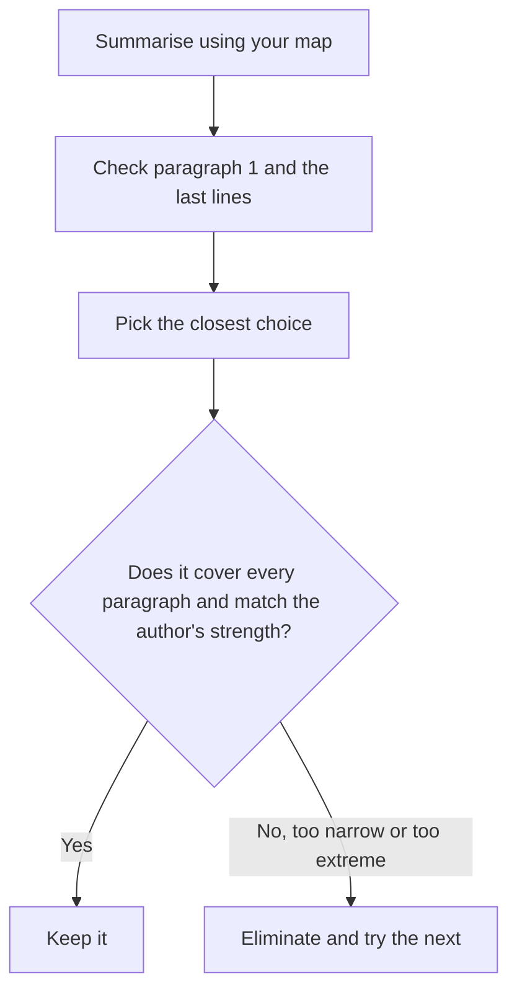

# Main Idea and Primary Purpose Questions

Almost every GMAT passage comes with a question about the big picture: "What is the main idea?" or "What is the primary purpose of the passage?" They look easy, and they are the questions people most often miss, because four of the five choices are built from true details that are just the wrong size.

## What these questions are really asking

A main-idea question asks **what the author wants you to walk away believing**. A primary-purpose question asks **what the author is doing** (arguing, describing, explaining, challenging). They're two sides of one coin. The idea is the content, and the purpose is the action.

Typical stems:

- "The primary purpose of the passage is to..."
- "The main idea of the passage is that..."
- "Which of the following best states the central argument?"
- "The author's primary concern is to..."

> [!REMEMBER]
> The right answer covers **the whole passage**, not one paragraph, and it reflects **the author's own point**, not a view the author is only reporting.

## The three-step method

1. **Before looking at the choices, summarise.** Use your map. Finish this sentence: "The author is [verb]-ing that/to ______." Eight to fifteen words.
2. **Check the first and last paragraphs.** The author's thesis tends to appear at the end of paragraph 1 or in the last sentences of the passage. If your summary doesn't match those, rethink it.
3. **Match, then test.** Pick the choice closest to your summary. Then test it: does it cover all paragraphs? Does it use the right strength (no "always" or "proves")?

Main idea and purpose questions follow this path.

## The verbs in purpose answers

For primary-purpose questions the **verb** often decides the answer before you've read the rest of the choice. Learn what each verb implies.

| Verb | Means the author is... | Fits a passage that... |
|---|---|---|
| **describe** | laying out features or a state of affairs, without a strong opinion | surveys a phenomenon, a field, a history |
| **explain** | showing how or why something happens | gives mechanisms, causes |
| **argue** / **advocate** | taking a position and defending it | has a clear thesis and evidence |
| **challenge** / **question** / **refute** | attacking an existing view | opens with "traditionally..." then counter-evidence |
| **propose** | offering a new idea or fix | ends with a solution |
| **compare** / **contrast** | setting two things side by side | spends equal time on both |
| **evaluate** / **assess** | weighing strengths and weaknesses | gives pros, cons and a verdict |
| **reconcile** | showing two apparently conflicting ideas can both be true | resolves a puzzle |

> [!TIP]
> If the author is clearly critical of a view, "describe" is nearly always too weak. If the author is simply laying out a landscape, "argue" or "challenge" is too strong. Match the verb to the author's energy.

## The two classic traps

### Too narrow

A **too-narrow** choice is true, but covers only one paragraph or one example. It's the commonest wrong answer on main-idea questions. If a choice mentions a specific detail (a number, a named person, one case study), be suspicious.

### Too broad

A **too-broad** choice goes beyond the passage. It's the kind of sentence that would suit a textbook chapter heading, not this passage. If the passage is about one proposed explanation for a phenomenon, "scientists don't understand the phenomenon" is too broad.

### Other traps

- **Opposite**: the choice reverses the author's attitude.
- **Reported view**: the choice states what "some critics" think, not the author.
- **Half right**: the first half matches, the second half adds something the passage never claims.
- **Extreme wording**: "completely", "always", "proves", "the only".

> [!TRAP]
> A choice that sounds like the opening sentence of the passage is often a trap. Opening sentences set the topic, but the main idea usually comes after the pivot ("however", "yet"). Read to the end of the passage before you choose.

## A model passage

*Passage:*

> Conventional wisdom holds that a company's pricing power depends chiefly on how much its product costs to make. The reasoning is straightforward: firms with higher costs must charge more, and those with lower costs can charge less. This view has intuitive appeal, but it confuses two separate questions. What a firm *must* charge to break even is a fact about its accounts. What a firm *can* charge is a fact about its customers.
>
> Consider two bakeries on the same street. One uses imported flour and charges twice as much as the other, which uses local flour. Yet both are full at lunchtime. The first bakery's customers are buying a story about provenance as well as bread, and they are willing to pay for it. The second bakery's customers care about price and convenience. Neither owner is irrational. Each has simply found a group of customers whose priorities match what the bakery offers.
>
> The practical lesson is that managers who set prices by adding a margin to cost are leaving money on the table, or pricing themselves out of the market. A more reliable starting point is an honest account of what the target customer values.

### Worked example 1 (Easy)

The primary purpose of the passage is to

(A) describe how bakeries compete in a crowded market
(B) challenge the idea that costs determine pricing power and recommend a customer-focused approach
(C) argue that low-cost firms are always less profitable than high-cost firms
(D) explain why imported flour is more valuable than local flour
(E) show that managers rarely understand their own accounts

Show solution

The answer is **(B)**. My map: "P1: challenges the cost view. P2: bakery example. P3: recommends customer focus." (B) has the right verbs (challenge, recommend) and covers all three paragraphs.

(A) is too narrow: the bakeries are only the example in paragraph 2.
(C) uses "always", which the passage never claims. It only says cost doesn't determine pricing power.
(D) misreads the example. The author doesn't say imported flour is more valuable, only that some customers value provenance.
(E) is outside the scope. The passage never says managers misunderstand their accounts.

**Trap:** (A). The bakeries take up the most space, so they feel like the topic. But examples serve the argument, they aren't the argument.

### Worked example 2 (Medium)

Which of the following best states the main idea of the passage?

(A) Pricing should start with an understanding of what customers value, not with the firm's costs.
(B) Companies that charge higher prices tend to attract more loyal customers.
(C) Break-even analysis is an outdated accounting tool.
(D) Customers are usually willing to pay more for imported goods.
(E) Pricing decisions are too complex for managers to make reliably.

Show solution

The answer is **(A)**. It restates the final paragraph and the distinction in paragraph 1 ("must" versus "can").

(B) introduces loyalty, which isn't discussed.
(C) The author says break-even is "a fact about its accounts", not that it's outdated.
(D) generalises from one example ("usually"). The passage only says *some* customers pay for provenance.
(E) The author actually gives a practical recommendation, so "too complex" contradicts the tone.

## Two views: whose main idea is it?

Many passages contain a **conflict**: a traditional view and a newer one, or two schools. The main idea is usually the author's position on that conflict. Pay attention to whether the author:

- sides with one view (then the main idea includes that side),
- finds merit in both (then the main idea is a reconciliation or a qualified position),
- stays neutral and only reports (then the purpose is "describe" or "compare").

### Worked example 3 (Medium-Hard)

> Archaeologists have traditionally explained the abandonment of the Bronze Age settlement at Karanis by pointing to a single climatic shock, a prolonged drought. Soil cores from the surrounding plain do indicate a dry spell. But the cores also show that the dry spell began at least a century before the site was deserted, and a settlement of that size would be expected to adapt within a generation.
>
> A growing minority of researchers instead emphasise the collapse of the regional trade network that supplied Karanis with copper. Without copper, the town's workshops lost their main source of income, and families moved to be near surviving markets. This explanation is attractive, though it rests largely on indirect evidence, since no documents from the period survive.
>
> The most defensible position, then, is that neither factor alone suffices. Drought may have weakened the town's farming base, leaving it vulnerable when the trade network failed.

The primary purpose of the passage is to

(A) prove that a trade collapse, not a drought, caused the abandonment of Karanis
(B) outline two explanations for the abandonment of Karanis and argue that a combination of them is most plausible
(C) describe the methods archaeologists use to analyse soil cores
(D) show that archaeologists cannot explain why ancient settlements were abandoned
(E) criticise researchers who rely on indirect evidence

Show solution

The answer is **(B)**. Map: "P1: drought theory and its problem. P2: trade theory and its weakness. P3: author combines them."

(A) "Prove" is far too strong, and the author explicitly says neither factor alone suffices.
(C) is too narrow: soil cores are one piece of evidence in paragraph 1.
(D) is too broad and too negative. The author thinks a good explanation is available.
(E) is a distortion. The author notes the trade theory rests on indirect evidence, but calls it "attractive". There's no criticism of researchers as such.

**Trap:** (A). Paragraph 2 is vivid, but the author's conclusion is in paragraph 3. Don't stop reading at the exciting part.

### Worked example 4 (Hard)

> Biographers of the economist Joan Robinson often treat her late shift toward development economics as an abandonment of her earlier, more theoretical work. This reading is tempting, because the surface subject matter did change: the elegant models of imperfect competition gave way to field reports on agrarian economies. Yet the continuity is easy to see once one notices what her earlier work was about. Her models of monopsony, in which a single buyer dominates a market, were always intended to explain why wages in some labour markets fall below what a competitive market would pay. The villages she later described were precisely such markets.
>
> To read her later work as a retreat from theory is therefore to mistake a change of setting for a change of purpose.

Which of the following best states the main point of the passage?

(A) Joan Robinson's later writings on development were less rigorous than her earlier theoretical work.
(B) Joan Robinson's move to development economics applied, rather than abandoned, the concerns of her earlier theory.
(C) Biographers have generally misunderstood the models of imperfect competition.
(D) Monopsony is a more useful concept in development economics than in theory.
(E) Joan Robinson changed the subject matter of her research several times in her career.

Show solution

The answer is **(B)**. The author challenges the biographers' reading ("abandonment") with a continuity argument: the same problem (wage-suppressing buyer power) appears in both periods.

(A) is the biographers' view, not the author's.
(C) overreaches. The author disputes one reading of her career, not the models themselves.
(D) is a comparison the passage never makes.
(E) "Several times" is unsupported. The passage mentions one shift, and treats the change as superficial.

**Trap:** (A). It restates the position the author is arguing *against*. In two-view passages, always confirm which side the author is on.

## Purpose verbs in practice

When you read a purpose question, try this quick test on every verb: **would the author say "I am ___-ing"?**

- "I am describing three types of coral." Fine for a survey passage.
- "I am arguing that this explanation is incomplete." Fine for a critique.
- "I am proving that X is true." Rarely right, since GMAT authors are usually careful and qualified.

> [!SHORTCUT]
> Cross out choices with absolute verbs ("prove", "demonstrate conclusively", "refute entirely") unless the passage truly shows a decisive result. Reasonable, qualified verbs ("suggest", "argue", "propose", "question") are far more often correct.

## Quick check

1. A passage has four paragraphs. Paragraph 3 is an extended story about one factory. A choice summarises only that story. Is it likely correct?

Answer

No. It is probably too narrow, because it covers one paragraph only. The main idea has to account for the whole passage.

2. The author spends one paragraph describing a popular theory, two paragraphs showing its weaknesses and a final paragraph offering a better theory. Pick the best verb: describe, propose, challenge or compare.

Answer

"Challenge" (and then "propose" for the end). A verb like "describe" would underplay the author's critique.

3. Why is "scientists have not yet discovered the cause of the phenomenon" often a poor main-idea choice for a passage that proposes and tests one specific cause?

Answer

It's too broad (and may even be the opposite). The passage is about a particular proposal, not a general state of ignorance.

## Key takeaways

- A main-idea answer covers the **whole passage** and states the **author's** point.
- A purpose answer begins with a verb. Match its strength to the author's energy (describe, explain, argue, challenge, propose).
- Too-narrow (a detail or example) and too-broad (beyond scope) are the two biggest traps.
- Don't mistake a reported view ("some historians argue") for the author's view.
- Summarise in your own words **before** you read the choices.
- Beware extreme words: "prove", "always", "only", "completely".
- Read to the last paragraph. The thesis often comes after the pivot.

## Go deeper

- [GMAT Club forum](https://gmatclub.com/forum/): search "Reading Comprehension primary purpose" for hundreds of student discussions of the traps above.
- [Official GMAT exam page](https://www.mba.com/exams/gmat-exam): official information on the Verbal section.
