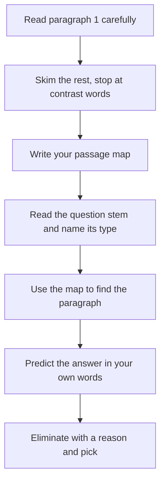

# How to Read a GMAT Passage

Reading Comprehension is roughly a third to a half of the Verbal section on the GMAT Focus Edition: expect 2 to 4 passages, each followed by 3 to 4 questions. The passages are dense and academic, and most people lose points not because they can't understand them, but because they read them the wrong way. This lesson fixes that.

## The big idea: read for structure, not for detail

Think of a GMAT passage like a building you're visiting for the first time. On your first walk through, you don't memorise what's in every cupboard. You learn where the main rooms are and what each room is for. If someone later asks "where's the kitchen?", you know which door to open.

That's the whole strategy. On the first read you build a **map** of the passage. When a question asks about a specific detail, you use the map to find the right paragraph and then **go back and read the exact lines**. The passage stays on screen the entire time. It's an open-book test, so memorising is wasted effort.

> [!REMEMBER]
> You're not reading to remember. You're reading to know **where things are**, **what each part is doing**, and **what the author thinks**.

## Active reading: ask four questions as you go

Passive reading is when your eyes move and your brain doesn't. Active reading means you keep asking the passage questions, almost like a conversation:

1. **What's the topic?** (Usually clear by sentence two.)
2. **What's the problem, puzzle or debate?** (Passages almost always have one: a theory that doesn't fully work, a trend nobody expected, two groups who disagree.)
3. **What does the author think?** (Sometimes neutral, often with a quiet opinion.)
4. **Why is this paragraph here?** (Is it giving background, an example, a counterpoint, a conclusion?)

If you can answer those four by the end of the passage, you're ready for almost any question.

## The passage map

While reading on screen, you can jot a tiny map on your note board. The map has three parts:

- **One line per paragraph**, written as the paragraph's job, not its content. For example: "P1: old view of X", "P2: new evidence against", "P3: author's fix".
- **The author's main point**, in one short sentence.
- **The tone**: neutral, supportive, cautious, skeptical or critical.

A good map is 15 to 25 words in total. If yours is longer, you're copying instead of summarising.

> [!TIP]
> Write verbs, not nouns. "P2: challenges tidal theory" is far more useful than "P2: tides, moon, 1950s data". The verb tells you the paragraph's role, and roles are what structure questions test.

## Keywords: the signposts

Authors leave signposts all over a passage. Learn to spot four families and you'll read twice as fast.

| Type | Examples | What it tells you |
|---|---|---|
| **Contrast** | but, however, yet, although, despite, in contrast, whereas, nevertheless | The ground is about to shift. The idea *after* the signal is usually the important one. |
| **Continuation** | moreover, furthermore, in addition, similarly, likewise | More of the same. You can skim. |
| **Emphasis** | importantly, crucially, in fact, indeed, notably, above all | The author is flagging something that matters. |
| **Opinion** | unfortunately, surprisingly, fortunately, remarkably, a flawed approach, a compelling case | The author's own attitude is leaking through. |

Two more families are worth a glance: **cause and result** (because, therefore, thus, as a result) and **example markers** (for instance, such as, consider). Examples are usually safe to skim on the first read, because you only need to know *that* an example exists and what it illustrates.

> [!TRAP]
> Watch for the words "some", "many", "researchers believe", "it has been argued". These usually introduce a view the author is **about to dispute**. If you treat "researchers believe" as the author's own view, you'll pick the answer that the passage actually argues against.

## The four passage types

GMAT passages fall into four families. They all use the same reading method, but knowing the family helps you predict the structure.

- **Science and medicine**: usually a puzzle, a hypothesis, evidence, and a caveat. Watch for "researchers had assumed... but new data suggest...". You never need outside knowledge.
- **Social science and history**: often a debate between schools of thought, or a revision of a long-held view. Expect labels like "traditional accounts" versus "recent scholarship".
- **Business and economics**: typically a trend, a cause for the trend, and a limitation or counter-example. Watch for numbers, but you rarely need to compute with them.
- **Humanities and arts**: critics versus an artist's intent, or a reassessment of a movement or writer. Tone words matter most here, because the author's attitude is often the real question.

> [!NOTE]
> Don't panic about unfamiliar topics. The test writers deliberately pick subjects most people know nothing about, and everything you need is in the text. A passage about deep-sea sponges is no harder than one about coffee, it just sounds scarier.

## Reading speed versus comprehension

On the GMAT Focus you have about 45 minutes for 23 Verbal questions, so roughly 1 minute 55 seconds per question on average. For a 3-question passage plus reading, a good target is **about 3 minutes of reading and mapping** for a long passage, and **under 2 minutes** for a short one. Questions then take about 60 to 90 seconds each.

Here's the trade-off nobody tells you. If you read too slowly (trying to understand every phrase), you run out of time. If you read too fast (skimming without a map), you re-read three times per question and lose more time. The sweet spot is a **steady, focused first read at about 220 to 250 words per minute** while hunting only for structure.

You do not need to understand every sentence. If a sentence is dense with technical terms, ask "is this the main claim or an example?" If it's an example, move on.

## What to do on the first read versus when answering

**First read (about 2 to 3 minutes):**

1. Read the first paragraph carefully. It sets the topic and usually hints at the debate.
2. For each later paragraph, read the first sentence and the last sentence closely, and skim the middle for signposts.
3. Stop at every contrast word and ask "what changed?"
4. Pause for 10 seconds at the end and write your map.

**When answering (about 60 to 90 seconds per question):**

1. Read the question stem first, and decide what **type** it is (main idea, detail, inference, function, application).
2. Use your map to jump to the right paragraph. Never answer a detail question from memory.
3. Predict the answer in your own words before you look at the choices.
4. Eliminate choices with a reason ("too strong", "wrong paragraph", "opposite"). Don't pick the one that "sounds nice".

Here is the whole RC routine as one flow, from first read to final choice.

> [!TIP]
> The first question on a passage is often the main idea. Answer it first even if it's not listed first, and your map will already hold the answer. If the first question is a hard detail, don't be afraid to answer it after you've warmed up on easier ones. (You can't skip and return in the Focus Edition, but you can decide how long to spend.)

## Short passages versus long passages

Short passages (about 200 to 300 words) usually have 3 questions and one or two paragraphs. The whole thing is close to one idea, so your map is tiny: "context, then problem, then the author's point". Spend about 90 seconds reading.

Long passages (about 350 to 450 words) have 3 to 4 questions and 3 or 4 paragraphs. They often contain **two competing views** and the author's evaluation of them. Here the map matters a lot. Spend about 2.5 to 3 minutes reading, and don't be tempted to re-read the whole thing for every question.

### Worked example 1 (Easy)

Read the passage, then write a map: one line per paragraph, the author's point, and the tone.

*Passage:*

> For decades, urban planners assumed that building wider roads would ease traffic congestion. The logic seemed obvious: more lanes mean more space, and more space means fewer delays. Yet studies of cities that expanded their highways have found that congestion often returned within a few years, sometimes at levels worse than before.
>
> Economists call this effect "induced demand." When roads become faster, more people choose to drive, and some who previously used trains or buses switch to cars. The new capacity fills up. A more promising approach, many researchers now argue, is to manage demand directly, for example through pricing schemes that charge drivers more at peak hours.

Show solution

**P1:** states the old assumption (wider roads cut traffic), then challenges it with evidence (congestion returns). Note the "Yet" at the start of the last sentence: that is the pivot.

**P2:** explains why (induced demand), then suggests an alternative (pricing).

**Author's point:** Building more road capacity doesn't solve congestion; managing demand is more promising.

**Tone:** mildly critical of the old view, cautiously supportive of pricing ("many researchers now argue", "more promising"). The author reports rather than shouts.

That's the whole map in under 25 words: "P1: old view, then evidence against. P2: why, plus a better idea. Point: capacity doesn't fix congestion, demand management might. Tone: critical of old, cautiously supportive of new."

**Trap:** copying details like "within a few years" into the map. You can find that later if a question asks.

### Worked example 2 (Medium)

Which of these sentences is the **best** one-line summary of paragraph 2 of the passage above?

(A) Economists disagree about whether road building is beneficial.
(B) Faster roads attract more drivers, so the extra capacity gets used up, which is why researchers are looking at pricing.
(C) Pricing schemes have been proven to reduce congestion in many cities.
(D) People who use trains and buses are more likely to switch to cars when roads are cleared.
(E) Induced demand is a recent discovery by economists.

Show solution

The answer is **(B)**. It captures both jobs of the paragraph: it explains the mechanism, and it points to the alternative.

(A) invents a disagreement among economists. The paragraph says economists have *named* the effect, not that they disagree.
(C) is too strong. The author says researchers argue pricing is "more promising", not "proven".
(D) is half of an example from the paragraph, turned into a general claim ("more likely") that the text never makes.
(E) says "recent discovery". The passage never dates the idea.

**Trap:** (C). "Proven" is far stronger than "more promising".

### Worked example 3 (Medium)

Circle the signposts in this paragraph, and say what each one tells you.

> Many analysts have argued that the success of the Mumbai suburban railway comes mainly from its low fares. This view is understandable but incomplete. In fact, ticket prices on several comparable systems are even lower, and yet their ridership has stagnated. What distinguishes the Mumbai network is frequency: trains arrive, in peak hours, every three minutes.

Show solution

- "**Many analysts have argued**": a view the author is about to dispute.
- "**understandable but incomplete**": the contrast word *but* plus the opinion marker *incomplete*. The author is partly agreeing, then pushing back.
- "**In fact**": emphasis. What follows is the author's evidence.
- "**even lower, and yet**": a second contrast. Cheaper systems didn't get the ridership.
- "**What distinguishes**": a pointer to the author's own answer: frequency.

So the paragraph's job is "dispute the fares explanation, then offer frequency". If a question asks "why does the author mention comparable systems?", the answer is: to show that low fares alone don't explain success.

### Worked example 4 (Hard)

> Historians of the textile trade have long attributed the decline of handloom weaving in nineteenth-century India to a single cause: the arrival of cheap machine-made cloth from Britain. The explanation is neat, and it fits the surviving trade statistics. But it leaves unexplained why some handloom regions, notably in the south, not only survived but expanded their output over the same decades.
>
> A more careful account looks at what each region wove. Weavers who made plain, everyday cloth competed head-on with imports and lost. Those who produced elaborate saris and ceremonial fabrics, by contrast, served buyers for whom a machine-made substitute was not really a substitute at all. The decline, in short, was real but uneven, and to explain it by imports alone is to mistake an average for a rule.

The author's tone toward the "single cause" explanation is best described as:

(A) dismissive
(B) neutral
(C) respectful but unconvinced
(D) enthusiastically supportive
(E) puzzled

Show solution

The answer is **(C)**. Look at the opinion markers: "neat" and "fits the surviving trade statistics" are concessions, so the author isn't dismissive. But "But it leaves unexplained" and "to mistake an average for a rule" show the author thinks the explanation is incomplete.

(A) is too harsh. The author grants it fits the data.
(B) misses the clear evaluative language in the last sentence.
(D) is the opposite.
(E) The author isn't puzzled. The author has an answer (regional differences in product type).

**Trap:** (A). People see "mistake" and jump to "dismissive". Always weigh the whole paragraph. A single sharp phrase doesn't set the tone if the author has been politely conceding points.

## A practice drill to build stamina

Stamina is the real enemy on test day, because passage 3 comes when you're already tired. Here's a simple three-week plan.

- **Week 1: map only.** Take 5 passages a day (from any source, even a long magazine article from *The Economist*, *Aeon* or *Scientific American*). Read each in 2 to 3 minutes, write the map, and compare with the passage's actual structure. Don't answer questions yet.
- **Week 2: map plus main idea.** Do the same, and write the main idea in one sentence before reading anything else. Then check: did the author's final paragraph confirm it?
- **Week 3: full passages under time.** Complete 3 passages in a row (about 12 minutes), the way they'd feel in a real section. Review every wrong answer and label *why* it was wrong: wrong paragraph, too strong, opposite, outside scope or half right.

> [!TIP]
> Read one long-form article each day on your commute. Pick topics you'd normally avoid: geology, monetary policy, medieval trade. You're training your brain to stay calm when the vocabulary gets thick.

## Quick check

1. In the sentence "Many biologists have assumed that birds evolved flight from the ground up, but new fossils suggest otherwise," whose view does the author hold?

Answer

The author holds the *new fossils* view, the one after "but". The "many biologists" view is the one being challenged.

2. You've just finished reading a passage. Which is more useful on your note board: a list of the three key facts from paragraph 2, or "P2: gives evidence against theory"?

Answer

The second. A line describing the paragraph's job helps with function, structure and main-idea questions, and tells you where to look for detail questions.

3. Is "furthermore" a contrast, continuation or emphasis signpost?

Answer

Continuation. The next idea adds to the previous one in the same direction, so you can usually move faster.

4. A question asks, "According to the passage, what percentage of the sample showed improvement?" Should you answer from your memory of the passage?

Answer

No. Use your map to find the right paragraph, then re-read the sentence and pick the answer that matches it. Memory is where distortions creep in.

## Key takeaways

- Read for **structure and viewpoint**, not for detail. The passage stays on screen.
- Build a map: one line per paragraph (as a job, with a verb), the author's point, and the tone.
- Contrast words (but, however, yet) usually point to the idea that matters most. "Some argue" usually points to a view the author will challenge.
- Four passage families (science, social science, business, humanities) share one reading method. Unfamiliar topics are normal and everything you need is in the text.
- Aim for about 90 seconds on a short passage and 2.5 to 3 minutes on a long one, then 60 to 90 seconds per question.
- Answer detail questions by going back to the text, never from memory.
- Build stamina deliberately: map-only practice first, then timed sets of three passages.

## Go deeper

- [GMAT Club forum](https://gmatclub.com/forum/): large Reading Comprehension discussion archive where you can read how others map and attack passages.
- [Official GMAT exam page](https://www.mba.com/exams/gmat-exam): the source for current format and section timing.
- [Aeon](https://aeon.co/): long-form essays on science, history and philosophy, great for stamina training.
